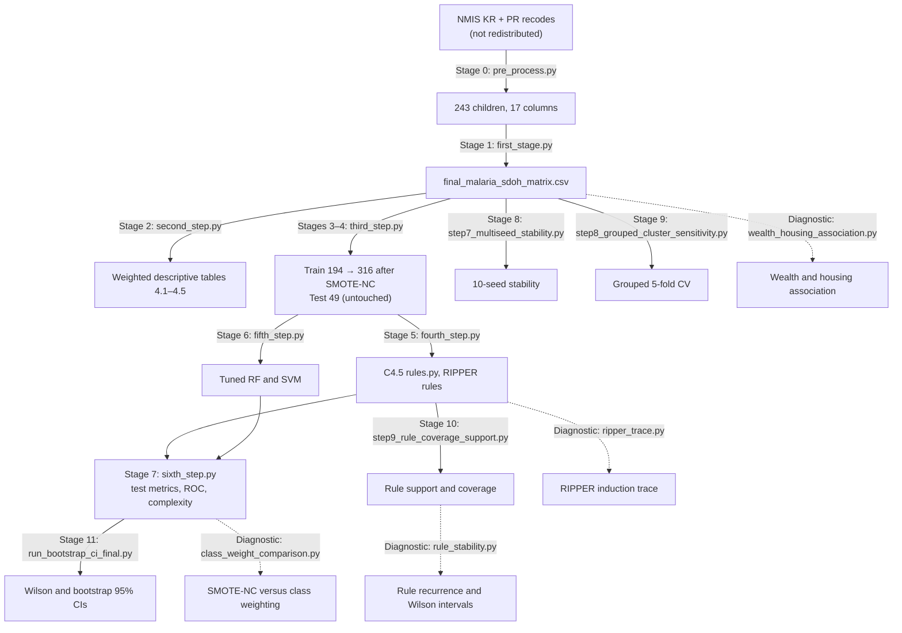

# Technical Guide for Examiners

**Thesis:** A Social Determinants Analysis of Malaria Risk in Rural Nasarawa State Using Transparent Rule-Based Logic (MSc Computer Science)
**Revised thesis file:** `Full_Work_revised_3.docx`
**How to run the code:** [REPRODUCIBILITY.md](REPRODUCIBILITY.md)

This guide explains what each stage of the analysis does, why it was designed that way, and what it produced. Every number below is taken from the files in `outputs/`, and the file is named next to each result.

---

## 1. Scope of the study

The study is an exploratory evaluation of transparent rule-based classifiers on survey data. It is not a clinical decision-support system and makes no claim to clinical validity. It asks whether distal social determinants of health (SDoH) from the 2021 Nigeria Malaria Indicator Survey can classify microscopy-confirmed malaria in rural Nasarawa children, and how transparent models (C4.5, RIPPER) compare with a majority-class baseline (Zero-R), logistic regression, Random Forest and an SVM.

The main finding is negative. On the test set no model discriminated well (ROC-AUC 0.4181–0.6056), and RIPPER detected none of the nine infected children. Repeated splits and grouped cross-validation confirm that performance is weak and unstable. The induced rules are presented as candidate patterns for further study, not as validated pathways.

---

## 2. Pipeline overview

---

## 3. Stage by stage

### Stage 0: cohort extraction (`pre_process.py`, Table 3.1)

The script reads the Children's Recode (KR) and the Household Member Recode (PR) and applies the filters in Table 3.1:

| Step | Condition | Children remaining |
| :--- | :--- | ---: |
| KR file | all child records | 10,988 |
| Alive | `b5 == 1` | 10,645 |
| Listed in household roster | `b16 > 0` | 10,469 |
| Aged 6–59 months | `6 <= b19 <= 59` | 9,510 |
| Nasarawa State | `v024 == 15` | 330 |
| Rural | `v025 == 2` | 245 |
| Merged with PR on `hv001`, `hv002`, `hvidx` | all 245 matched | 245 |
| Microscopy result available | `hml32` in {0, 1} | 243 |
| Bed-net record available | `hml20` in {0, 1} | 243 |
| No duplicate child records | unique `hv001`, `hv002`, `hvidx` (0 duplicates) | 243 |

Notes:

* `b16` is the child's line number in the household roster. `b16 > 0` therefore keeps children listed in the household, which is what makes the KR–PR merge possible. All 243 children in the final cohort also slept in the household the night before the survey (`hv103 = 1`).
* The outcome is Giemsa blood-smear microscopy (`hml32`). The rapid diagnostic test result (`hml35`) is not used, because HRP2 antigen can persist after the parasites have cleared.
* The final cohort has 198 negative and 45 positive children in 139 households and 9 enumeration areas (clusters).

### Stage 1: variable typing (`first_stage.py`)

Age (`b19`) is kept as an integer, so that C4.5 can place numeric thresholds on it. The ten nominal predictors (`b4`, `v106`, `v119`, `v158`, `v127`, `v128`, `v129`, `v113`, `v116`, `hml20`) are stored as category codes rather than numbers, so that no model treats a code such as wall type 31 as larger than 21. Wealth quintile (`v190`) is kept as its 1–5 code and treated as categorical by SMOTE-NC and by the tree. The script also records the column positions SMOTE-NC needs to identify categorical features.

### Stage 2: weighted descriptive statistics (`second_step.py`, Tables 4.1–4.5, Figure 4.1)

Survey weights are used here only. Each child's weight is `v005 / 1,000,000` (the weights sum to 185.0152 over the cohort), and the script reports weighted percentages and weighted malaria prevalence for every category. The weighted prevalence is 18.76%, against a raw 18.52% (45/243), and the weighted negative-to-positive ratio is 4.33:1.

`v005` is the women's sample weight. Within this cohort, which lies in a single survey stratum, it is a constant multiple (0.9512) of the household weight `hv005`. Every weighted proportion is therefore identical whichever weight is used.

Weights are not used for model training or evaluation. The rule learners and scikit-learn models are fitted on the unweighted records, and the test metrics describe performance on the observed children. The weighted figures are estimates for the analytic subset only; complex-survey standard errors were not computed.

### Stages 3–4: split and oversampling (`third_step.py`, Table 4.6)

* Stratified 80/20 split (`random_state=42`): training 194 children (158 negative, 36 positive); test 49 children (40 negative, 9 positive).
* Identifiers and weights (`hv001`, `hv002`, `hvidx`, `v005`) are removed from the predictors.
* SMOTE-NC (`k = 5`, `random_state=42`) is applied to the training set only. It adds 122 synthetic positives, giving 316 training records (158/158). The 194 original rows are kept first and saved separately (`X_train_original.csv`), so that later stages can evaluate rules on real records only.
* The test set is never resampled.

SMOTE-NC interpolates age and assigns each nominal feature the most common value among the neighbours, so synthetic records can combine attributes that no real household has. Stage 10 measures how much this inflates the apparent precision of the rules.

### Stage 5: rule induction (`fourth_step.py`, `c45_tree_utils.py`; Figure 4.5, Figure I.1)

**C4.5 (ChefBoost 0.0.19, `config={'algorithm': 'C4.5'}`).** The tree is grown on the 316 resampled records using the gain ratio. Points to be aware of:

* ChefBoost applies **no post-pruning**. The tree is limited only by its stopping rules, with a default maximum depth of 5.
* For a numeric feature with many distinct values, ChefBoost tries a small set of candidate thresholds (the minimum, maximum and mean, and the mean plus or minus multiples of the standard deviation) rather than every midpoint. The root split `b19 <= 6` is the minimum age. It isolates six children who are exactly 6 months old (5 training, 1 test), none of them infected.
* ChefBoost writes the tree as Python `if/else` code in `outputs/rules/rules.py`. `c45_tree_utils.py` parses that file into an explicit tree, checks that its predictions match the file's own function on every record, and uses it to count records per leaf and to draw Figures 4.5 and I.1. The tree has 46 leaves. Thirty are reached by training records; the other 16 are fallback leaves that ChefBoost writes for category values not seen at a node.

**RIPPER (Wittgenstein 0.3.5, `RIPPER(random_state=42)`, `pos_class=1`).** The code uses the library defaults (`k = 2`, `prune_size = 0.33`, `dl_allowance = 64`). The learned rule set has two positive-class rules and a default negative rule:

* R1: `v113 = 31 ∧ v127 = 34 ∧ v116 = 31 ∧ b4 = 2 ∧ v129 = 31 ∧ hml20 = 0`
* R2: `v128 = 21 ∧ v129 = 31 ∧ b19 in 14.0–17.0` (Wittgenstein's age bin, which covers ages 15–17 months)

### Stage 6: benchmark tuning (`fifth_step.py`, Table 4.7)

Random Forest and SVM pipelines use a `ColumnTransformer`: `StandardScaler` on age and `OneHotEncoder(handle_unknown='ignore')` on the nominal features. They are tuned with `GridSearchCV` (5-fold `StratifiedKFold`, shuffled, `random_state=42`, scoring macro F1) on the **194 original training rows**. SMOTE-NC runs inside an imbalanced-learn `Pipeline`, so it is fitted on each training fold only and every validation fold contains real records. The selected configuration is then refitted on the 316 resampled records.

| Model | Grid | Selected (`outputs/models/best_params.json`) | CV macro F1 |
| :--- | :--- | :--- | :---: |
| Random Forest | `n_estimators` {50, 100, 200, 300}; `max_depth` {None, 5, 10, 15}; `min_samples_split` {2, 5, 10} | 50 trees, depth 5, `min_samples_split` 10 | 0.5061 |
| SVM | `C` {0.1, 1, 10, 100}; `gamma` {scale, auto, 0.01, 0.1, 1}; `kernel` {rbf, linear, poly} | RBF, `C` 1, `gamma` 0.01 | 0.5518 |

Logistic regression (`C = 1.0`, `max_iter = 1000`, same preprocessing) is not tuned.

### Stage 7: test-set evaluation (`sixth_step.py`, Tables 4.8 and 4.9, Figures 4.2–4.4 and 4.6)

All six models are evaluated once on the 49 untouched test children. ROC-AUC needs a continuous score:

* **C4.5:** each leaf gets the Laplace-corrected share of positive training records that reach it, `(k + 1) / (n + 2)` (Provost & Domingos, 2003), fitted on the 316 resampled records. An empty fallback leaf inherits the score of its nearest non-empty ancestor. The hard-label curve is also computed: it has only three points, and its area (0.4792) equals balanced accuracy.
* **RIPPER:** Wittgenstein's `predict_proba`.
* **Logistic regression, Random Forest, SVM:** `predict_proba`.

PR-AUC is computed as average precision (`average_precision_score`). Its no-skill baseline is the test prevalence, 9/49 = 0.1837.

### Stage 8: repeated splits (`step7_multiseed_stability.py`, Table 4.8.1)

The full split → SMOTE-NC → fit → evaluate sequence is repeated for seeds 10, 20, 30, 42, 50, 60, 70, 80, 90 and 100, for all six models. C4.5 is refitted with ChefBoost each time. Random Forest and SVM reuse the hyperparameters from Stage 6 rather than being re-tuned per seed.

### Stage 9: grouped cross-validation (`step8_grouped_cluster_sensitivity.py`, Table 4.8.2)

Five-fold cross-validation is run on the 243 children under three schemes:

* **A:** `StratifiedKFold` on rows.
* **B:** `GroupKFold` on households (`hv001` and `hv002` combined, 139 groups).
* **C:** `GroupKFold` on enumeration areas (`hv001`, 9 groups).

SMOTE-NC (`k = 5`) is applied inside each training fold. A fold whose test part contained a single class would be logged and skipped; in this run all five folds were used in every scheme.

### Stage 10: rule support and coverage (`step9_rule_coverage_support.py`, Tables 4.10 and 4.11)

For each named C4.5 pathway, each C4.5 leaf and each RIPPER rule, the script reports support (n), coverage, true and false positives, precision and recall on three cohorts:

* the 316 resampled training records;
* the 194 original training records;
* the 49 test children.

The script asserts that its RIPPER rule matching reproduces `ripper.predict` exactly.

### Stage 11: confidence intervals (`run_bootstrap_ci_final.py`, Table 4.8)

The script reads the stored test predictions (`outputs/models/test_predictions.npz`). It computes Wilson score 95% intervals (without continuity correction) for accuracy, sensitivity, specificity, precision and negative predictive value. It computes non-parametric bootstrap percentile intervals for every metric (B = 1,000, seed 42); the thesis reports the bootstrap intervals for F1, macro F1, ROC-AUC and PR-AUC. All models are scored on the same bootstrap resamples, and a resample containing only one class is redrawn.

### Diagnostics outside Stages 0–11

These four scripts are run separately ([REPRODUCIBILITY.md](REPRODUCIBILITY.md), Section 4).

**SMOTE-NC versus class weighting (`class_weight_comparison.py`, Table 4.8.3).** Logistic regression, Random Forest and the SVM are trained with `class_weight='balanced'` and no oversampling, using the same preprocessing and search grids as Stage 6. On the 194 original training rows the grid search selected a Random Forest with 100 trees, no depth limit and `min_samples_split` 2, and a polynomial SVM with `C` 100 and `gamma` 0.01. As in Stage 8, these settings are reused for the ten seeds and logistic regression is not tuned. C4.5 and RIPPER are excluded because ChefBoost and Wittgenstein have no class-weight option. Threshold adjustment was not evaluated.

The class-weighted SVM's ROC-AUC and PR-AUC use `decision_function` scores. Its `predict_proba` scores were inverted relative to them (correlation −0.995 on the test set), giving a ROC-AUC of 0.3611 instead of 0.6389. The script logs both values.

**Rule stability and precision intervals (`rule_stability.py`, Tables 4.10, 4.11 and 4.11.1).** C4.5 and RIPPER are refitted on the ten partitions of Stage 8, with SMOTE-NC on each training split. For each reported rule the script counts the partitions in which it recurs in two ways:

* **Exact:** the same conditions, including RIPPER's age bin.
* **Nominal conditions contained:** a rule of the same class contains all of the reported rule's nominal conditions, possibly with others.

A C4.5 leaf counts only if training records reach it. The script also computes Wilson 95% intervals for rule precision on the original training records and the test set. It gives none for the resampled records, because synthetic records are not independent observations.

**RIPPER induction trace (`ripper_trace.py`, Algorithm 3.2, Section 4.2.4.3).** The script refits the Stage 5 RIPPER model with Wittgenstein's verbose output switched on and asserts that the traced fit gives the same rule set as a silent fit. `outputs/logs/ripper_trace.log` records four phases:

| Phase | Result |
| :--- | :--- |
| A. Grow the initial rule set | 15 rules grown; stopped by the description-length limit (70.9 bits against an allowance of 64) |
| B. Optimisation (`k = 2`) | No changes; halted at the first iteration |
| C. Cover remaining positives | New rules only repeated existing ones |
| D. Delete rules that increase total description length | 13 distinct rules deleted, leaving R1 and R2 |

Wittgenstein's RIPPER has no condition that stops at a 50% error rate. That check exists only in its separate IREP class, which the pipeline does not use.

**Wealth and housing association (`wealth_housing_association.py`, Section 4.2.1).** The script measures how strongly wealth quintile (`v190`) is associated with wall, floor and roof material, drinking-water source and toilet facility. It reports Cramér's V and the bias-corrected V (Bergsma, 2013), with permutation p-values (10,000 permutations, seed 42). These are household attributes, so the thesis reports one record per household (139); the child-level values (243) are in the same output file. The analysis is unweighted. Part of the association is expected, because the wealth index is built partly from housing characteristics.

| Wealth quintile with | Bias-corrected V (139 households) | Permutation p |
| :--- | ---: | ---: |
| Wall material | 0.439 | 0.0001 |
| Floor material | 0.413 | 0.0001 |
| Roof material | 0.410 | 0.0001 |
| Toilet facility | 0.444 | 0.0001 |
| Drinking-water source | 0.204 | 0.0055 |

---

## 4. Key results

### Test set (N = 49, 9 positive)

From `outputs/test_point_metrics.csv`; the intervals come from `outputs/table_4_8_bootstrap_ci.csv`.

| Model | TN | FP | FN | TP | Accuracy | Sensitivity (Wilson 95% CI) | Specificity | Macro F1 | ROC-AUC (bootstrap 95% CI) | PR-AUC |
| :--- | ---: | ---: | ---: | ---: | ---: | :--- | ---: | ---: | :--- | ---: |
| Zero-R | 40 | 0 | 9 | 0 | 81.63% | 0.00% [0.0, 29.9] | 100.00% | 0.4494 | 0.5000 | 0.1837 |
| Logistic regression | 30 | 10 | 7 | 2 | 65.31% | 22.22% [6.3, 54.7] | 75.00% | 0.4848 | 0.6028 [0.40, 0.79] | 0.2374 |
| C4.5 | 25 | 15 | 6 | 3 | 57.14% | 33.33% [12.1, 64.6] | 62.50% | 0.4632 | 0.4181 [0.16, 0.67] | 0.1846 |
| RIPPER | 37 | 3 | 9 | 0 | 75.51% | 0.00% [0.0, 29.9] | 92.50% | 0.4302 | 0.4625 [0.42, 0.50] | 0.1837 |
| Random Forest | 31 | 9 | 6 | 3 | 69.39% | 33.33% [12.1, 64.6] | 77.50% | 0.5455 | 0.5889 [0.36, 0.80] | 0.2717 |
| SVM | 26 | 14 | 5 | 4 | 61.22% | 44.44% [18.9, 73.3] | 65.00% | 0.5143 | 0.6056 [0.38, 0.82] | 0.2788 |

Every ROC-AUC interval includes 0.5; for RIPPER, 0.5 is the upper limit. Every PR-AUC interval includes the 0.1837 baseline. With nine positive test children, one child changes sensitivity by 11.1 percentage points.

### Model complexity (`outputs/tradeoff_matrix.csv`, Table 4.9)

RIPPER has 2 rules; logistic regression 46 coefficients (age plus one per category of the 11 nominal variables); C4.5 46 leaves (30 reached by training records); Random Forest 50 trees; the SVM 273 support vectors.

### Repeated splits (`outputs/multiseed_stability_results.csv`, Table 4.8.1)

Mean ± SD over 10 seeds:

| Model | Sensitivity | ROC-AUC |
| :--- | :--- | :--- |
| Logistic regression | 33.33 ± 16.56 | 0.5539 ± 0.0851 |
| C4.5 | 40.00 ± 22.35 | 0.4175 ± 0.1330 |
| RIPPER | 15.56 ± 15.00 | 0.4926 ± 0.0530 |
| Random Forest | 25.56 ± 16.60 | 0.5175 ± 0.1164 |
| SVM | 43.33 ± 16.10 | 0.5893 ± 0.0956 |

Zero-R is constant: sensitivity 0, ROC-AUC 0.5.

### Grouped cross-validation (`outputs/grouped_cluster_sensitivity_results.csv`, Table 4.8.2)

Mean ROC-AUC over 5 folds:

| Model | A: rows | B: households | C: clusters |
| :--- | ---: | ---: | ---: |
| Logistic regression | 0.5156 | 0.5512 | 0.5442 |
| C4.5 | 0.4680 | 0.4714 | 0.5188 |
| RIPPER | 0.5090 | 0.5156 | 0.4898 |
| Random Forest | 0.4915 | 0.4768 | 0.4943 |
| SVM | 0.5655 | 0.5112 | 0.5031 |

Performance is weak under all three schemes, and grouping by household or cluster does not cause a consistent drop. The grouped schemes therefore give no evidence that household or cluster leakage inflated the row-split results. Equally, there was little performance to inflate.

### SMOTE-NC versus class weighting (`outputs/class_weight_comparison.csv`, `outputs/class_weight_multiseed.csv`, Table 4.8.3)

| Model | Method | Reported split: sensitivity % | Reported split: macro F1 % | Reported split: ROC-AUC | 10 seeds: sensitivity % (mean ± SD) | 10 seeds: macro F1 % (mean) | 10 seeds: ROC-AUC (mean) |
| :--- | :--- | ---: | ---: | ---: | :--- | ---: | ---: |
| Logistic regression | SMOTE-NC | 22.22 | 48.48 | 0.6028 | 33.33 ± 16.56 | 49.41 | 0.5539 |
| Logistic regression | Class weights | 33.33 | 46.32 | 0.4806 | 34.44 ± 15.23 | 44.86 | 0.5000 |
| Random Forest | SMOTE-NC | 33.33 | 54.55 | 0.5889 | 25.56 ± 16.60 | 47.63 | 0.5175 |
| Random Forest | Class weights | 22.22 | 48.48 | 0.5278 | 10.00 ± 8.20 | 44.91 | 0.4171 |
| SVM | SMOTE-NC | 44.44 | 51.43 | 0.6056 | 43.33 ± 16.10 | 51.70 | 0.5893 |
| SVM | Class weights | 55.56 | 61.37 | 0.6389 | 28.89 ± 15.00 | 52.56 | 0.5375 |

Class weighting gives no consistent gain. On the reported split the class-weighted SVM detected five of nine infections against four with SMOTE-NC, but over ten partitions SMOTE-NC had the higher mean ROC-AUC for all three models and the higher mean sensitivity for the Random Forest and the SVM. The standard deviations overlap widely and no formal test was performed.

### Rule precision on real versus synthetic records (Tables 4.10 and 4.11)

The base rate in the 194 original training records is 36/194 = 18.56%.

| Rule | Resampled (n, precision) | Original (n, precision) | Test (n, precision) |
| :--- | :--- | :--- | :--- |
| C4.5 C2 (no radio, no net, protected well, metal/zinc roof) | 124, 80.65% | 35, 31.43% | 9, 22.22% |
| C4.5 C3 (no radio, no net, surface water, no maternal education) | 49, 53.06% | 28, 17.86% | 5, 0.00% |
| C4.5 C4 (no radio, no net, borehole or unprotected well, bamboo-with-mud walls) | 28, 60.71% | 17, 35.29% | 4, 25.00% |
| C4.5 C5 (no radio, net use, electricity, wealth quintile 2) | 1, 100% | 1, 100% | 0, — |
| RIPPER R1 | 56, 92.86% | 8, 50.00% | 2, 0.00% |
| RIPPER R2 | 17, 88.24% | 5, 60.00% | 1, 0.00% |

Most of the apparent precision on the resampled set comes from synthetic records. Pathway C1 (`b19 <= 6`, predicting negative) covers the six 6-month-old children noted in Stage 5.

### Rule recurrence and precision intervals (`outputs/rule_stability_summary.csv`, `outputs/rule_precision_wilson.csv`, Tables 4.10, 4.11 and 4.11.1)

| Rule | Exact recurrence (of 10 partitions) | Nominal conditions contained (of 10) | Original records: correct/n, precision [Wilson 95% CI] | Test: correct/n, precision [Wilson 95% CI] |
| :--- | ---: | ---: | :--- | :--- |
| C4.5 C1 | 8 | 8 | 5/5, 100.00% [56.6, 100.0] | 1/1, 100.00% [20.7, 100.0] |
| C4.5 C2 | 1 | 1 | 11/35, 31.43% [18.6, 48.0] | 2/9, 22.22% [6.3, 54.7] |
| C4.5 C3 | 1 | 1 | 5/28, 17.86% [7.9, 35.6] | 0/5, 0.00% [0.0, 43.4] |
| C4.5 C4 | 1 | 1 | 6/17, 35.29% [17.3, 58.7] | 1/4, 25.00% [4.6, 69.9] |
| C4.5 C5 | 1 | 1 | 1/1, 100.00% [20.7, 100.0] | 0/0, n/a |
| RIPPER R1 | 1 | 1 | 4/8, 50.00% [21.5, 78.5] | 0/2, 0.00% [0.0, 65.8] |
| RIPPER R2 | 1 | 3 | 3/5, 60.00% [23.1, 88.2] | 0/1, 0.00% [0.0, 79.3] |

Pathways C2–C5 and rules R1 and R2 recurred exactly only at seed 42, the partition from which they were induced. Pathway C1 recurs in eight partitions because it reflects the cohort's minimum age, not a stable risk pattern. RIPPER induced 2 to 7 rules (mean 4.9), and C4.5 reached 17 to 39 leaves. Individual variables were steadier than their combinations (`outputs/logs/rule_stability.log`).

---

## 5. Where the assessment report's requests are addressed

| Assessment report request | Where it is addressed |
| :--- | :--- |
| Participant flow and household/cluster counts (Section 5) | Stage 0; Table 3.1; `step0_data_ingestion.log` |
| Correct `hml32`/`hml35` and `hml20` definitions (Section 5) | Stage 0; Tables 2.1 and 3.2 |
| Distinguish weighted descriptive results from unweighted modelling (Section 5) | Stage 2; Section 3.2.4 and Table 4.1 note |
| Describe model configurations as implemented (Section 5) | Stages 5–6; Algorithm 3.1, Table 3.3, Table 4.7, `best_params.json` |
| Versions, scripts outside Word, execution logs (Section 5) | [REPRODUCIBILITY.md](REPRODUCIBILITY.md); `requirements.txt`, `uv.lock`; `outputs/logs/` |
| Confidence intervals (Section 6) | Stage 11; Table 4.8 |
| Repeat across random seeds (Section 6) | Stage 8; Table 4.8.1 |
| Zero-R and logistic regression baselines (Section 6) | Stage 7; Table 4.8 |
| Household/cluster-grouped analysis (Section 6) | Stage 9; Table 4.8.2 |
| PR-AUC (Section 6) | Stage 7; Table 4.8 |
| Rule support and coverage (Sections 6–7) | Stage 10; Tables 4.10 and 4.11 |
| Correct the C4.5 ROC (Section 6) | Stage 7; Chapter 3 Step 7; Figure 4.4 |
| Compare SMOTE-NC with at least one alternative (Section 5) | `class_weight_comparison.py`; Table 4.8.3 (class weighting for three learners; threshold adjustment not evaluated) |
| Rule confidence intervals and stability (Sections 7 and 10) | `rule_stability.py`; Tables 4.10, 4.11 and 4.11.1 |

---

## 6. Limitations of the computational evidence

* **Small test set.** The test set has 49 children and 9 positives, so all test metrics have wide intervals (Section 4).
* **Single tree and rule set.** The rules in Tables 4.10 and 4.11 come from one fit on one oversampled training set. Refitting on ten partitions showed that the positive pathways and rules recurred exactly only in the reported split (Table 4.11.1), so they should be read as properties of that split.
* **Imbalance methods.** Class weighting was compared with SMOTE-NC only for logistic regression, the Random Forest and the SVM, without a formal test. Threshold adjustment was not evaluated.
* **Synthetic records.** SMOTE-NC creates attribute combinations that may not occur in real households, and the rules' precision on real records is much lower than on the resampled set.
* **ChefBoost behaviour.** There is no post-pruning, only a limited set of numeric thresholds is tried, and fallback leaves are written for unseen category values. The unbalanced root split on age is a product of these choices.
* **Survey design.** Survey weights and design are ignored in modelling, and no design-based standard errors are reported for the descriptive estimates.
* **Tested environment.** Results were produced and checked on one platform (Section 3 of [REPRODUCIBILITY.md](REPRODUCIBILITY.md)).
